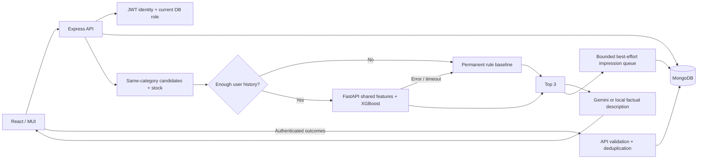

# Interview notes — Restock

## 60-second explanation

“I extended a deployed grocery-substitution app into a measurable ranking system. Express owns auth, catalog, stock and interaction events. A frozen MiniLM encoder creates product vectors; XGBoost LambdaMART learns a ranking from shown-item click/cart/purchase labels. Python serves scores over an internal HTTP endpoint. Node applies category/stock constraints, returns the top three and lets Gemini describe the selected products. Rules remain the permanent cold-start and outage fallback.

There were no real users, so I built and documented a seeded preference-based simulator. I used chronological splits, timestamp-safe features and a label-maturity embargo. The model beats the baseline on that held-out simulated experiment. I do not claim those metrics establish real-user improvement.”

Hinglish: “Weighted formula ko ML naam nahi diya. Actual XGBoost train kiya, artifact save kiya aur same test slates pe baseline se compare kiya. Data simulated hai, isliye real-user performance ka claim nahi hai.”

## Architecture

The browser never receives the ML service token or Gemini key. Product/inventory routes use controllers/services/models. Recommendation orchestration stays in the root module; the older recommendation controller is unused. The inventory model is explicitly bound to `inventory`. Both repos use feature branches from `develop`.

## Major changes: what, why and interview language

| Change | Why | Concept | How I would say it |
|---|---|---|---|
| Customer/admin identity, scrypt passwords, expiring JWTs | Associate behavior with real accounts and enforce writes | Authentication vs authorization; least privilege | “User identity JWT se aati hai; admin role server DB se verify karta hai.” |
| Attributed impressions and outcomes | Learn preferences from what was shown and what followed | Implicit feedback; exposure logging; idempotency | “Sirf impression log se relevance learn nahi hoti. Outcomes aur exposure IDs join kiye.” |
| Background impressions + acknowledged outcome writes | Avoid blocking recommendation response on analytics | Latency vs delivery guarantee | “Queue bounded hai aur best effort hai; crash pe loss possible hai. Durable outbox next improvement hai.” |
| MiniLM vectors cached by model revision/text | Add semantic product similarity without repeatedly encoding text | Transfer learning; content-addressed caching | “Cosine ek feature hai; embedding khud final ranker nahi hai.” |
| Seeded simulator with hidden preferences | No real users existed; test personalization honestly | Generative simulation; selection/position bias | “Labels baseline formula se generate nahi kiye. Brand loyalty aur budget jaisi hidden preferences use ki.” |
| Shared temporal features + chronological embargo | Prevent future outcomes from inflating offline quality | Point-in-time correctness; train-serving parity | “Prediction time ke baad ka event kisi feature mein nahi aata.” |
| XGBoost `rank:ndcg` | Learn relative order with graded relevance per request | Gradient boosting; LambdaMART learning-to-rank | “Classifier click probability learn karta; ranker query ke andar better ordering optimize karta hai.” |
| Evaluated artifacts and live Insights API | Make every quality claim inspectable | Reproducibility; model lineage | “Metrics manually type nahi kiye UI mein; actual evaluation artifact se aate hain.” |
| Cold-start gate, timeout and response validation | Keep browsing functional for new users and failures | Graceful degradation; bounded latency | “Model slow/down ho toh same deterministic baseline serve hota hai, engine response mein visible hai.” |

## Baseline that remains available

Same-category alternatives only, excluding the source. Score:

`0.4*category + 0.2*priceSimilarity + 0.2*(rating/5) + 0.2*inStock`.

Price similarity is `max(0, 1 - abs(candidatePrice-sourcePrice)/max(sourcePrice,1))`, with a capped 0.1 cheaper-item bonus. Scores round to three decimals; stock takes priority over score; ties use product ID. ML filters out unavailable candidates. Rule fallback preserves the existing out-of-stock alternatives when stock is scarce. Evaluation compares both methods on identical shown in-stock candidates, so the offline result is a reranking comparison, not a measurement of that policy difference.

## Training data and labels

The catalog, users and behavior are synthetic. Each user has private category preferences, preferred brands, budget, price sensitivity, brand loyalty and rating sensitivity. A noisy nonlinear utility creates click probability, reduced by display position. Cart and purchase are conditional funnel events. These private preferences never become training features. Source IDs/user IDs are grouping/history keys, not numerical features.

Every example is `(user, source product, actually shown candidate)` at impression time. Randomized six-item slates provide exposure support. Join outcomes by exposure ID, user and product within 24 hours. Ignored=0, click=1, cart=2, purchase=3; use the strongest outcome. Unshown items have unknown labels and are never sampled as negatives. VIEW/FEEDBACK are stored but not relevance labels in v1. Ignore end-of-window impressions without a full 24-hour observation period.

Real API events always use server-derived `source: real`, and the offline generator always writes `source: simulated`. The simulator never imports its events into Atlas. The local smoke test uses a separate disposable database; its generated QA actions are not training observations. No verified order system exists yet, so API purchase events remain self-reported signals.

## Features and leakage control

| Feature | Calculation known at prediction time |
|---|---|
| category match | Candidate category equals source category |
| embedding cosine | Dot product of normalized pinned MiniLM vectors of name/category/brand/description |
| price difference / ratio | Snapshot candidate/source price difference and ratio |
| candidate rating | Snapshot rating / 5 |
| popularity | log(1 + weighted positive events in previous 14 days) |
| in stock | Candidate snapshot quantity > 0 |
| brand match | Candidate brand equals source brand |
| user category affinity | Share of prior positive-event weight in candidate category |
| user brand affinity | Share of prior positive-event weight for candidate brand |
| user price fit | exp(-absolute difference from weighted mean prior log(1+price)); 0.5 without history |
| recency | Product age in days from creation snapshot |
| trend velocity | (last-seven-day positive weight minus preceding-seven-day weight) / 7 |

Prior CLICK/CART/PURCHASE weights are 1/2/3. Histories use the latest 1,000 strictly earlier positive events with stored product snapshots. No current label, future aggregate, hidden user parameter or shown position enters the feature matrix. Product text changes create a different embedding cache key. Historical prices/brands/stock are not silently replaced with current catalog values.

A global chronological request split assigns 60% train, 20% validation, 20% test. Rows whose 24-hour labels overlap the next split are removed. Earlier observed validation/test events may update later histories, matching online behavior; model weights remain frozen. This tests returning users, not unseen-user generalization. Validation chooses depth and early stopping; test does not choose hyperparameters. `features.py` is shared by the dataset builder and scoring service.

Category and stock are constant after business filtering, so their learned importance is zero. That is expected. User-price fit currently uses a global spending history, which can mix categories; a category-relative price representation is a reasonable future experiment.

## Why XGBoost ranking?

Features are tabular, and the task is ordering a small candidate set with graded relevance. LambdaMART uses within-request comparisons and a ranking objective. A binary click classifier would discard cart/purchase strength unless carefully weighted; a calibrated classifier would be useful if probabilities were required, but this UI needs relative rank. The returned margin is not a click probability or a confidence percentage.

This is real training: tree structures/parameters are learned from examples, selected using validation, saved as a UBJ artifact and loaded by the service. MiniLM provides frozen transferred representations; it is not fine-tuned here. A two-depth validation comparison is a limited search, not evidence that XGBoost is globally optimal. More complex neural/collaborative models should be justified by real data and measured gains.

## Actual measured results

Model **v1-f196f47d**, trained 2026-10-16T16:22:17.538594+00:00. Dataset checksum: `70c60cd198c912e0f6e80a611067e48f0fccb936fd498e943d8246bd9f7f46b3`.

**SIMULATED DATA. Not evidence of real-user performance.**

| Engine | Precision@3 | Recall@3 | NDCG@3 |
|---|---:|---:|---:|
| Rules | 0.129756 | 0.291864 | 0.213192 |
| XGBoost | 0.153077 | 0.345739 | 0.271443 |

1901 held-out requests; 1041 have a positive outcome. All-negative requests score zero.

- **Precision@3:** positive shown items in the top three, divided by three.
- **Recall@3:** positive shown items recovered in the top three, divided by all positive items in that exposed slate. This is not full-catalog recall.
- **NDCG@3:** top-three discounted gain divided by the ideal top-three gain in that exposed slate. Gain is `2^grade−1`, discount is `log2(rank+1)`, so higher grades and earlier ranks matter more.

Paired request-bootstrap 95% interval for the ML-minus-rules NDCG difference: [0.042042, 0.074762]. Repeat users can correlate requests, so request-level intervals can be optimistic.

The model beats rules on this simulator because observed histories contain information about hidden brand/budget preferences that the nonpersonalized baseline ignores. The gain is modest, which is plausible given noisy outcomes and position-biased click labels. We did not inspect the simulator's latent probabilities to train/evaluate the ranker.

The ranker-only test scores are not measurements of the full deployed cold-start hybrid. Candidate retrieval is also not being evaluated: both engines rerank the same six shown products. See `ml-service/artifacts/EVALUATION.md`, `evaluation.json`, `metadata.json` and `eda.png` for the generated evidence.

## Cold start, integration and operations

Anonymous users and accounts with fewer than five distinct positively interacted products use rules. Distinct products prevent click/cart/purchase on one exposure from falsely making a user warm. Python scoring has a default 1.5-second deadline, and its response must contain one finite score per requested candidate with no foreign or duplicate IDs. Node owns the top-three ordering and filtering. If features/scoring fail, response metadata gives the actual fallback reason. Gemini has a separate timeout and local text fallback.

Impression/legacy logging is bounded and non-blocking, so a process crash or queue overflow can lose counts. Outcome writes are acknowledged and deduplicated; the two log collections are not an atomic transaction. Product cleanup is best effort across collections and events intentionally retain historical snapshots. These are concrete engineering limits, not claims of exactly-once production infrastructure.

Frontend uses sessionStorage bearer tokens and role-aware navigation; the API remains authoritative. Logout clears the session copy rather than revoking every token. No refresh/reset/email-verification flow is included. The app was published through GitHub browser PRs and deployed on Vercel/Render, including a CPU Docker scorer. The release record documents observed checks. No real-user experiment or sustained load test was performed.

## Likely questions and honest answers

**Is your data real?** No. The generator and assumptions are committed, all rows are labeled simulated, and quality claims are scoped to the simulator. Real events stay separable for retraining.

**Did you train on the baseline's own decisions?** The baseline supplies a comparison score, but user outcomes come from independent hidden preference utilities with noise and position bias. Six exposed candidates are randomly ordered. We do not generate labels by thresholding the baseline formula.

**Why not treat every non-purchased product as a negative?** Products the user never saw have unknown relevance. Only matured shown exposures can become weak negatives.

**How did you avoid leakage?** Features use strictly earlier events and historical product snapshots; request-based chronological splits have label-maturity gaps. Tests confirm that future/same-timestamp outcomes cannot change past features and labels outside the attribution window are ignored.

**Is randomized exposure enough to remove bias?** It improves exposure support; observed clicks still contain position bias. We do not claim unbiased latent relevance or counterfactual policy value. Logging propensities, examination modeling, user-clustered uncertainty and an online A/B test are future work.

**Why is category/stock importance zero?** Hard business filters make those features constant on eligible candidates. The features remain explicit for schema transparency, and constraints stay outside learned scores.

**Is Gemini the recommender?** No. Gemini only sees already selected products and describes factual attributes. It never returns candidates or controls their scores. Missing keys/quota/timeouts use local descriptions.

**Why is an ML score negative or near zero?** It is a learned ranking margin. Only relative order within a request matters. The UI does not label it as a probability or compare it numerically with rule percentages.

**What if the Python service is down?** Node's deadline or error handler returns the permanent deterministic baseline and an explicit engine/fallback reason. An actual slow HTTP test and an end-to-end real-model smoke test were run locally.

**Can you claim production readiness or revenue improvement?** No. Local tests and production smoke checks passed. Real-user validation, trusted order outcomes, durable logging, stronger deletion consistency and sustained resource/load testing remain future work.

**What would you improve first?** Collect consented, attributed real exposures/outcomes; verify purchases from orders; monitor delivery and latency; retrain with temporal snapshots; evaluate using users as uncertainty clusters; then run a controlled online experiment.

## Primary technical references used

- [Sentence Transformers: computing normalized embeddings](https://www.sbert.net/examples/sentence_transformer/applications/computing-embeddings/README.html)
- [XGBoost: learning-to-rank and query grouping](https://xgboost.readthedocs.io/en/stable/tutorials/learning_to_rank.html)
- [FastAPI: lifespan model loading](https://fastapi.tiangolo.com/advanced/events/)
